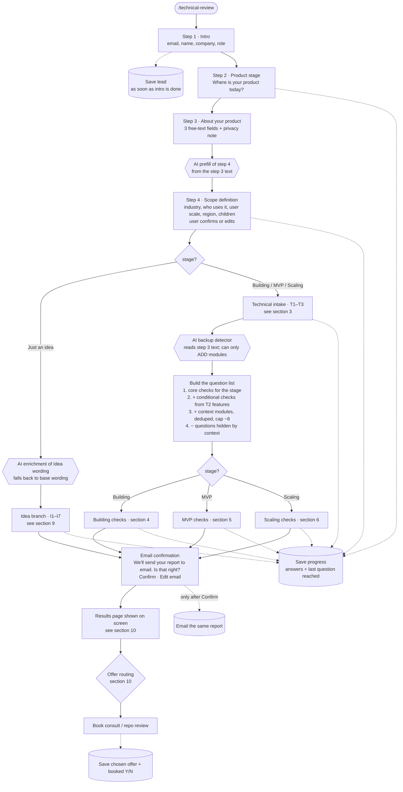
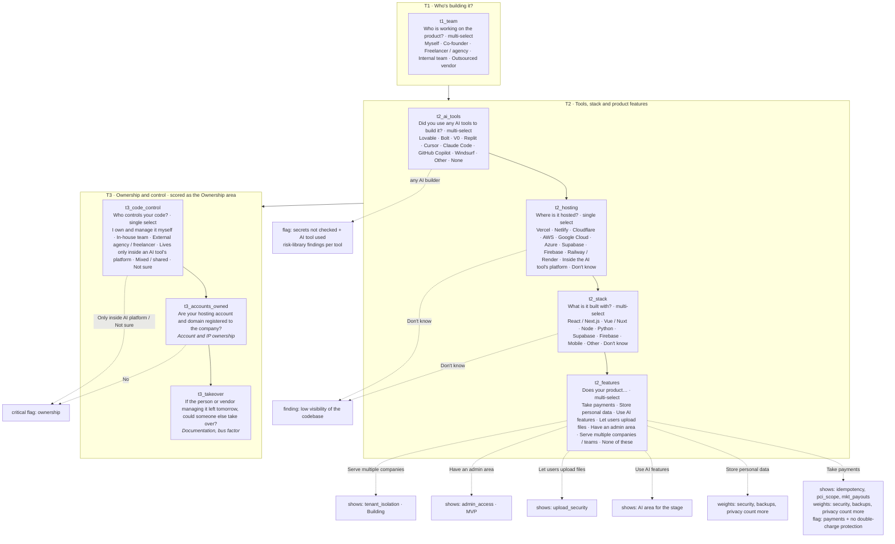
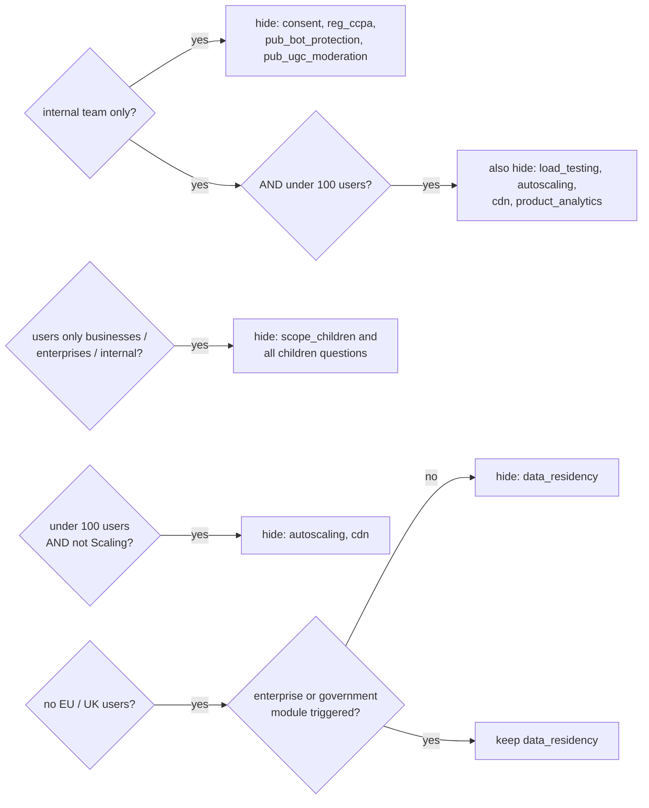
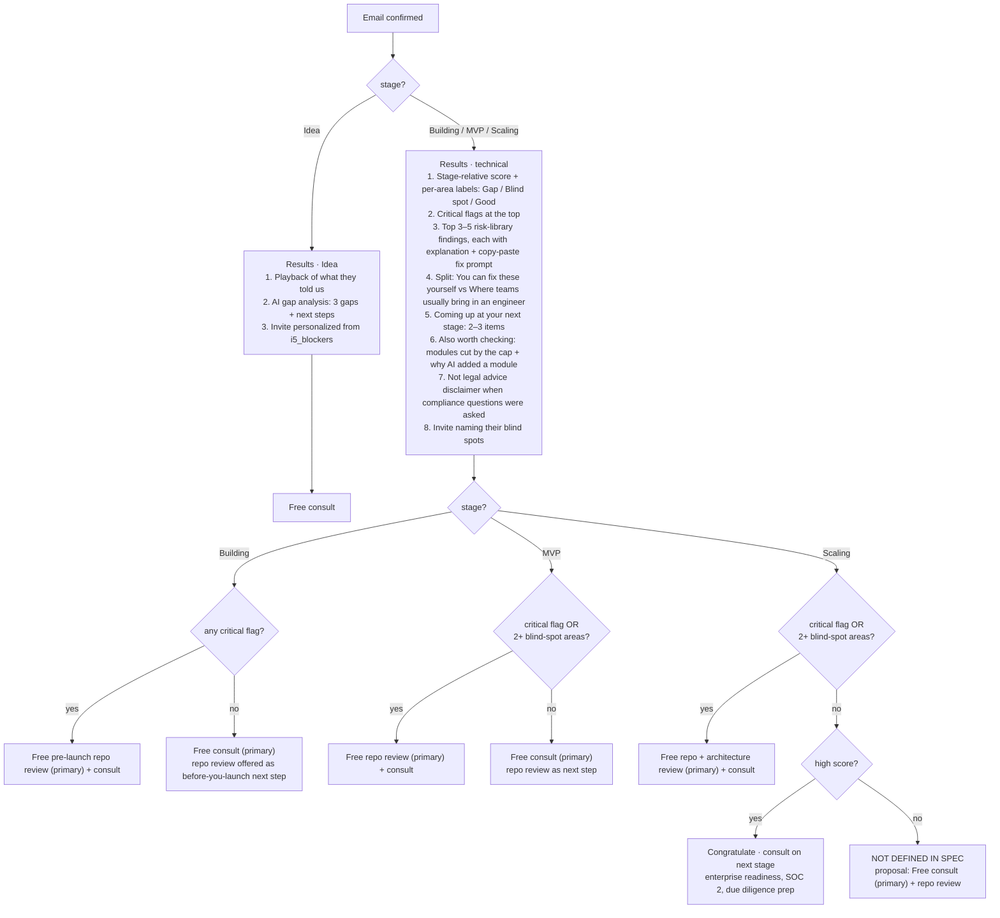

# Technical Review Flow (SPA-586)

Source of truth for the public `/technical-review` questionnaire: every question, the order it appears in, and the rules that show or hide it. The question catalog and rules engine in code must match this file. **Change this file first, then the code.**

Spec: [`SPA-586_build-public-technical-review-route-on-marketing-site.pdf`](../SPA-586_build-public-technical-review-route-on-marketing-site.pdf)

## How to read the diagrams

| Shape | Meaning |
|---|---|
| Solid box | Question always shown in that step / branch |
| Dashed box | Conditional question. The condition is in `[brackets]` at the start of the label |
| Diamond | Routing decision |
| Hexagon | AI step (optional; the flow works without it) |
| Cylinder | Data saved to the backend |

- The `id` in each box (e.g. `access_control`) is the stable ID the code uses. The same check keeps the same ID in every branch, even when the wording changes slightly per stage. That lets a module and a core question **dedupe**: if both add `load_testing`, it is asked once.
- Checks are **Yes / No / Unsure** unless stated otherwise. Every check is phrased so that **Yes is the good answer**.
- Stage tags: **B** = Building, **M** = MVP, **S** = Scaling.
- Every technical question shows a plain-English question plus a technical subtitle (in italics here). Wording never depends on role.

---

## 1. Overall flow

A progress bar is shown on every step. Target times: Idea, Building and MVP < 4 min; Scaling < 5 min.

---

## 2. Shared pages (all branches)

```mermaid
flowchart TD
    classDef cond stroke-dasharray: 5 5

    subgraph S1["Step 1 · Intro<br/>Takes about 4 minutes. You'll get a personalized report at the end."]
        direction TB
        intro_email["intro_email<br/>Where should we send your personalized report?<br/>Email · required"]
        intro_name["intro_name<br/>Your name<br/>Text · required"]
        intro_company["intro_company<br/>Company name<br/>Short text · optional"]
        intro_role["intro_role<br/>What best describes you?<br/>Founder · CTO / Head of Engineering · Product owner / PM · Operations · Other<br/>required · INTERNAL ONLY: never changes questions, wording, routing or results"]
        intro_email --> intro_name --> intro_company --> intro_role
    end

    subgraph S2["Step 2 · Product stage"]
        stage["stage<br/>Where is your product today?<br/>Just an idea · Building · MVP · Scaling<br/>required"]
    end

    subgraph S3["Step 3 · About your product<br/>Privacy note: We don't share this with anyone..."]
        direction TB
        about_company["about_company<br/>What does your company do?<br/>Short text"]
        about_product["about_product<br/>What does (or will) your product do?<br/>Short text"]
        about_audience["about_audience<br/>Who is it for?<br/>Short text"]
        about_company --> about_product --> about_audience
        req3["Required in Idea · optional in Building / MVP / Scaling"]
    end

    subgraph S4["Step 4 · Scope definition · prefilled by AI, user confirms · all required"]
        direction TB
        scope_industry["scope_industry<br/>Industry<br/>SaaS / B2B · Fintech · Healthcare / wellness · Insurance · E-commerce · Education · Real estate · Legal · Media · Marketplace · Government · Internal tool · Other"]
        scope_users["scope_users<br/>Who uses it? · multi-select<br/>The public · Small businesses · Large enterprises · Our internal team only · Government / public sector"]
        scope_scale["scope_scale<br/>How many users do you have, or expect within 12 months?<br/>Under 100 · 100–10,000 · 10,000–100,000 · 100,000+"]
        scope_region["scope_region<br/>Where are your users? · multi-select<br/>US · Canada · EU / UK · Australia / NZ · Other · Not sure yet"]
        scope_children["scope_children<br/>[Hidden if users are ONLY small businesses / large enterprises / internal team]<br/>Could children under 16 use it?<br/>Yes · No · Not sure"]:::cond
        scope_industry --> scope_users --> scope_scale --> scope_region --> scope_children
    end

    S1 --> S2 --> S3 --> S4
```

How step 4 is used:
- **Idea:** feeds AI enrichment of the Idea questions (section 9).
- **Building / MVP / Scaling:** triggers context modules, hides questions, and personalizes results (sections 7–8).

---

## 3. Technical intake (Building, MVP and Scaling)

Asked once, before the stage checks. These answers drive conditional checks, scoring weights, critical flags and stack-specific findings.

---

## 4. Building branch

**For:** work has started, not yet in users' hands. **Focus:** foundations that are cheap to get right now and expensive to fix later.
**Scored areas:** Ownership (T3) · Security foundations · Data & architecture · Launch readiness · AI (if applicable)

```mermaid
flowchart TB
    classDef cond stroke-dasharray: 5 5

    subgraph B_SEC["Security foundations"]
        direction TB
        access_control["access_control<br/>Have you checked that one user can never see another user's data?<br/><i>Access control, row-level security</i>"]
        auth_provider["auth_provider<br/>Is login handled by a trusted provider (e.g. Supabase Auth, Clerk, Auth0) rather than custom-built?<br/><i>Authentication</i>"]
        secrets_audit["secrets_audit<br/>Have you checked that no passwords or API keys are visible in your code or website?<br/><i>Secrets audit</i>"]
        mfa_infra["mfa_infra<br/>Do the accounts that control your product (hosting, code, database, domain) require two-step login?<br/><i>MFA on infrastructure accounts</i>"]
        input_validation["input_validation<br/>Is what users type into forms checked before it's saved or shown?<br/><i>Input validation, SQL injection, XSS</i>"]
        access_control --> auth_provider --> secrets_audit --> mfa_infra --> input_validation
    end

    subgraph B_DATA["Data & architecture foundations"]
        direction TB
        data_model["data_model<br/>Will your data structure still work if usage grows 10x or you add major features?<br/><i>Data model / schema design</i>"]
        tenant_isolation["tenant_isolation<br/>[if T2: serve multiple companies]<br/>Is each company's data clearly kept separate?<br/><i>Multi-tenancy / tenant isolation</i>"]:::cond
        idempotency["idempotency<br/>[if T2: take payments]<br/>Are you protected against charging a customer twice if a payment or webhook is sent twice?<br/><i>Idempotency</i>"]:::cond
        upload_security["upload_security<br/>[if T2: file uploads]<br/>Are uploaded files kept in proper file storage, checked for type and size, and private where needed?<br/><i>Object storage, upload security</i>"]:::cond
        data_model --> tenant_isolation --> idempotency --> upload_security
    end

    subgraph B_LAUNCH["Launch readiness"]
        direction TB
        staging["staging<br/>Is there a separate test version of the app, apart from the one users will use?<br/><i>Staging environment</i>"]
        backups["backups<br/>Are automatic database backups switched on?<br/><i>Backups</i>"]
        error_monitoring["error_monitoring<br/>Once you launch, would you find out if the app broke — before a user told you?<br/><i>Error monitoring, alerting</i>"]
        legal_basics["legal_basics<br/>Do you have a privacy policy and terms of service ready?<br/><i>Legal basics</i>"]
        consent["consent<br/>[hidden if internal team only]<br/>Will you ask users for permission before collecting their data (e.g. cookies, emails)?<br/><i>Consent management</i>"]:::cond
        pci_scope["pci_scope<br/>[if T2: take payments]<br/>Are card details handled entirely by your payment provider (e.g. Stripe), never stored by you?<br/><i>PCI scope</i>"]:::cond
        cross_browser["cross_browser<br/>Have you tested on different browsers and phones?<br/><i>Cross-browser / device testing</i>"]
        product_analytics["product_analytics<br/>[hidden if internal team only AND under 100 users]<br/>Will you be able to see how people use the product (which features, where they drop off)?<br/><i>Product analytics</i>"]:::cond
        staging --> backups --> error_monitoring --> legal_basics --> consent --> pci_scope --> cross_browser --> product_analytics
    end

    subgraph B_AI["AI features · [only if T2: use AI features]"]
        direction TB
        ai_prompt_injection["ai_prompt_injection<br/>Could a user trick the AI into ignoring its instructions or leaking data? (We've checked)<br/><i>Prompt injection</i>"]:::cond
        ai_data_exposure["ai_data_exposure<br/>Do you know what customer data gets sent to the AI provider?<br/><i>Data exposure to model vendors</i>"]:::cond
        ai_token_quota["ai_token_quota<br/>Is there a cap on how much AI usage one user can run up?<br/><i>Token quotas, LLM cost per user</i>"]:::cond
        ai_prompt_injection --> ai_data_exposure --> ai_token_quota
    end

    B_SEC --> B_DATA --> B_LAUNCH --> B_AI
    MODS["+ context modules tagged B<br/>inserted into the area they belong to · section 7"]
    B_AI --> MODS
```

---

## 5. MVP branch

**For:** live with early users or customers. **Focus:** protecting users, data and trust; knowing when things break; early compliance.
**Scored areas:** Ownership (T3) · Security · Reliability · Abuse & cost · Privacy · Releasing & quality · Visibility · Architecture · AI (if applicable)

```mermaid
flowchart TB
    classDef cond stroke-dasharray: 5 5

    subgraph M_SEC["Security"]
        direction TB
        access_control["access_control<br/>Have you checked that one user can never see another user's data?<br/><i>Access control, row-level security</i>"]
        secrets_audit["secrets_audit<br/>Have you checked that no passwords or API keys are visible in your code or website?<br/><i>Secrets audit</i>"]
        dependency_scan["dependency_scan<br/>Do you check the third-party packages you use for known security problems?<br/><i>Dependency vulnerability scanning</i>"]
        mfa_infra["mfa_infra<br/>Do the accounts that control your product (hosting, code, database, domain) require two-step login?<br/><i>MFA on infrastructure accounts</i>"]
        admin_access["admin_access<br/>[if T2: admin area]<br/>Is the admin area locked down so only the right people can reach it?<br/><i>Admin access control</i>"]:::cond
        upload_security["upload_security<br/>[if T2: file uploads]<br/>Are uploaded files checked for type and size, and kept private where needed?<br/><i>Upload security, storage permissions</i>"]:::cond
        access_control --> secrets_audit --> dependency_scan --> mfa_infra --> admin_access --> upload_security
    end

    subgraph M_REL["Reliability & recovery"]
        direction TB
        backup_restore["backup_restore<br/>If your database disappeared tomorrow, could you restore it — and have you tried?<br/><i>Backups and tested restore</i>"]
        error_monitoring["error_monitoring<br/>Would you find out if the app broke at 2am — before a customer told you?<br/><i>Error monitoring, alerting</i>"]
        uptime["uptime<br/>Would you know if the whole site went down?<br/><i>Uptime monitoring</i>"]
        rollback["rollback<br/>Can you undo a bad release quickly?<br/><i>Rollback</i>"]
        third_party_failure["third_party_failure<br/>If a service you depend on (payments, email, AI provider) goes down, does your app handle it gracefully?<br/><i>Third-party failure handling</i>"]
        backup_restore --> error_monitoring --> uptime --> rollback --> third_party_failure
    end

    subgraph M_ABUSE["Abuse & cost"]
        direction TB
        rate_limit["rate_limit<br/>Is it protected against one person (or a bot) overloading it with requests?<br/><i>Rate limiting</i>"]
        cost_alerts["cost_alerts<br/>Do you get an alert if your hosting or service bills spike?<br/><i>Cloud cost alerts, budget caps</i>"]
        ai_token_quota["ai_token_quota<br/>[if T2: AI features]<br/>Do you know what each user costs you in AI usage, and is there a cap?<br/><i>Token quotas, LLM cost per user</i>"]:::cond
        rate_limit --> cost_alerts --> ai_token_quota
    end

    subgraph M_PRIV["Privacy & compliance"]
        direction TB
        consent["consent<br/>[hidden if internal team only]<br/>Do you ask users for permission before collecting their data (e.g. cookies, emails)?<br/><i>Consent management</i>"]:::cond
        legal_basics["legal_basics<br/>Do you have a privacy policy and terms of service?<br/><i>Legal basics</i>"]
        gdpr_deletion["gdpr_deletion<br/>Could you delete everything you hold about a user if they asked?<br/><i>GDPR / data subject requests</i>"]
        pii_masking["pii_masking<br/>Do you hide sensitive information (names, emails, card details) in logs and screens where it isn't needed?<br/><i>PII masking / redaction</i>"]
        pci_scope["pci_scope<br/>[if T2: take payments]<br/>Are card details handled entirely by your payment provider, never stored by you?<br/><i>PCI scope</i>"]:::cond
        consent --> legal_basics --> gdpr_deletion --> pii_masking --> pci_scope
    end

    subgraph M_QA["Releasing & quality"]
        direction TB
        staging["staging<br/>Is there a separate test version of the app, apart from the live one?<br/><i>Staging environment</i>"]
        code_review["code_review<br/>Does someone review code changes before they go live?<br/><i>Code review / pull requests</i>"]
        e2e_tests["e2e_tests<br/>Are the most important flows (sign-up, login, payment) tested automatically?<br/><i>E2E tests on critical paths</i>"]
        db_migrations["db_migrations<br/>Are database changes made in a controlled, reversible way?<br/><i>Database migrations</i>"]
        staging --> code_review --> e2e_tests --> db_migrations
    end

    subgraph M_VIS["Visibility"]
        direction TB
        logging["logging<br/>If something went wrong last week, could you look up what happened?<br/><i>Logging</i>"]
        product_analytics["product_analytics<br/>[hidden if internal team only AND under 100 users]<br/>Do you know how people actually use the product (which features, where they drop off)?<br/><i>Product analytics</i>"]:::cond
        logging --> product_analytics
    end

    subgraph M_ARCH["Architecture"]
        direction TB
        race_conditions["race_conditions<br/>If two people do the same thing at the same moment (e.g. book the last slot, edit the same record), does the app handle it correctly?<br/><i>Race conditions, concurrency</i>"]
        idempotency["idempotency<br/>[if T2: take payments]<br/>Are you protected against charging a customer twice if a payment or webhook is sent twice?<br/><i>Idempotency</i>"]:::cond
        race_conditions --> idempotency
    end

    subgraph M_AI["AI features · [only if T2: use AI features]"]
        direction TB
        ai_prompt_injection["ai_prompt_injection<br/>Could a user trick the AI into ignoring its instructions or leaking data? (We've checked)<br/><i>Prompt injection</i>"]:::cond
        ai_data_exposure["ai_data_exposure<br/>Do you know what customer data gets sent to the AI provider?<br/><i>Data exposure to model vendors</i>"]:::cond
        ai_output_validation["ai_output_validation<br/>Do you check AI answers before they're shown or acted on (e.g. wrong facts, unsafe content)?<br/><i>Output validation, guardrails</i>"]:::cond
        ai_human_loop["ai_human_loop<br/>Is there a human check for high-stakes AI actions (e.g. sending emails, changing records, money)?<br/><i>Human-in-the-loop</i>"]:::cond
        ai_prompt_injection --> ai_data_exposure --> ai_output_validation --> ai_human_loop
    end

    M_SEC --> M_REL --> M_ABUSE --> M_PRIV --> M_QA --> M_VIS --> M_ARCH --> M_AI
    MODS["+ context modules tagged M<br/>inserted into the area they belong to · section 7<br/>100,000+ users also adds no_spof and incident_runbook"]
    M_AI --> MODS
```

---

## 6. Scaling branch

**For:** growing usage, team or customers. **Focus:** handling growth, staying up, passing enterprise security reviews, and an engineering process that holds up as the team grows.
**Scored areas:** Ownership (T3) · Security · Reliability · Performance & scale · Cost · Compliance & enterprise readiness · Visibility & vendors · Engineering process · AI (if applicable)

```mermaid
flowchart TB
    classDef cond stroke-dasharray: 5 5

    subgraph S_SEC["Security"]
        direction TB
        least_privilege["least_privilege<br/>Does each person and service only have access to what they need?<br/><i>Least privilege / RBAC</i>"]
        pentest["pentest<br/>Has anyone tried to break into it on purpose in the last year?<br/><i>Penetration test, SAST/DAST</i>"]
        dependency_scan["dependency_scan<br/>Do you check the third-party packages you use for known security problems?<br/><i>Dependency vulnerability scanning</i>"]
        mfa_infra["mfa_infra<br/>Do the accounts that control your product require two-step login?<br/><i>MFA on infrastructure accounts</i>"]
        audit_trail["audit_trail<br/>Can you see who changed important data or settings, and when?<br/><i>Audit trail</i>"]
        least_privilege --> pentest --> dependency_scan --> mfa_infra --> audit_trail
    end

    subgraph S_REL["Reliability & recovery"]
        direction TB
        backup_restore["backup_restore<br/>If your database disappeared tomorrow, could you restore it — and have you tested it recently?<br/><i>Tested backup restore, disaster recovery</i>"]
        incident_runbook["incident_runbook<br/>Is there a written plan for what to do when something goes badly wrong?<br/><i>Incident response / runbook</i>"]
        no_spof["no_spof<br/>Could the app keep running if any single part of it failed?<br/><i>No single points of failure</i>"]
        retries["retries<br/>When outside services fail or are slow, does the app retry sensibly instead of breaking?<br/><i>Retries, timeouts, circuit breakers</i>"]
        backup_restore --> incident_runbook --> no_spof --> retries
    end

    subgraph S_PERF["Performance & scale"]
        direction TB
        load_testing["load_testing<br/>[hidden if internal team only AND under 100 users]<br/>Do you know how many users it can handle at once?<br/><i>Load testing</i>"]:::cond
        autoscaling["autoscaling<br/>[hidden if internal team only AND under 100 users]<br/>Can the app automatically handle a sudden spike in traffic?<br/><i>Auto-scaling</i>"]:::cond
        db_performance["db_performance<br/>Do pages stay fast as your data grows?<br/><i>Database indexing, query performance</i>"]
        background_jobs["background_jobs<br/>Are slow tasks (emails, reports, AI processing) run in the background, so users aren't left waiting?<br/><i>Background jobs / queues</i>"]
        race_conditions["race_conditions<br/>If two people do the same thing at the same moment, does the app handle it correctly?<br/><i>Race conditions, concurrency</i>"]
        idempotency["idempotency<br/>[if T2: take payments]<br/>Are you protected against charging a customer twice if a payment or webhook is sent twice?<br/><i>Idempotency</i>"]:::cond
        load_testing --> autoscaling --> db_performance --> background_jobs --> race_conditions --> idempotency
    end

    subgraph S_COST["Cost"]
        direction TB
        cost_alerts["cost_alerts<br/>Do you get an alert if your hosting or service bills spike?<br/><i>Cloud cost alerts, budget caps</i>"]
        ai_token_quota["ai_token_quota<br/>[if T2: AI features]<br/>Do you know what each user costs you in AI usage, and is there a cap?<br/><i>Token quotas, LLM cost per user</i>"]:::cond
        cost_alerts --> ai_token_quota
    end

    subgraph S_COMP["Compliance & enterprise readiness"]
        direction TB
        soc2["soc2 · 4-option select<br/>Have customers asked for security certifications?<br/>Yes, we have one · Yes, we don't yet · Not yet asked · Unsure<br/><i>SOC 2 / ISO 27001</i>"]
        dpas["dpas<br/>Do you have data agreements with the services that handle your users' data?<br/><i>DPAs with sub-processors</i>"]
        data_residency["data_residency<br/>[hidden if no EU / UK users, unless enterprise or government module triggered]<br/>Do you know which country your users' data is stored in?<br/><i>Data residency</i>"]:::cond
        data_retention["data_retention<br/>Do you have a rule for how long you keep data?<br/><i>Data retention policy</i>"]
        gdpr_deletion["gdpr_deletion<br/>Could you delete everything you hold about a user if they asked?<br/><i>GDPR / data subject requests</i>"]
        accessibility["accessibility<br/>Can people using screen readers or keyboards use your product?<br/><i>Accessibility / WCAG</i>"]
        soc2 --> dpas --> data_residency --> data_retention --> gdpr_deletion --> accessibility
    end

    subgraph S_VIS["Visibility & vendors"]
        direction TB
        vendor_sbom["vendor_sbom<br/>Do you have a list of every outside service and library your product depends on?<br/><i>Vendor audit / SBOM</i>"]
        log_retention["log_retention<br/>Are logs kept long enough to investigate problems from weeks or months ago?<br/><i>Log retention</i>"]
        vendor_sbom --> log_retention
    end

    subgraph S_ENG["Engineering process"]
        direction TB
        cicd["cicd<br/>Are releases automated and reviewed, rather than done by hand?<br/><i>CI/CD, code review</i>"]
        regression_tests["regression_tests<br/>When you change something, is there an automatic check that you didn't break something else?<br/><i>Automated regression tests</i>"]
        feature_flags["feature_flags<br/>Can you turn a new feature on for some users only?<br/><i>Feature flags</i>"]
        prod_access["prod_access<br/>Is it clear who is allowed to release to the live app?<br/><i>Production access control</i>"]
        db_migrations["db_migrations<br/>Are database changes made in a controlled, reversible way?<br/><i>Database migrations</i>"]
        cicd --> regression_tests --> feature_flags --> prod_access --> db_migrations
    end

    subgraph S_AI["AI features · [only if T2: use AI features]"]
        direction TB
        ai_vendor_retention["ai_vendor_retention<br/>Is the AI provider prevented from training on or keeping your customers' data?<br/><i>Vendor data retention / training opt-out</i>"]:::cond
        ai_output_validation["ai_output_validation<br/>Do you check AI answers before they're shown or acted on?<br/><i>Output validation, guardrails</i>"]:::cond
        ai_fallback["ai_fallback<br/>If the AI provider is down or slow, does your app still work?<br/><i>Model fallback, timeouts</i>"]:::cond
        ai_evals["ai_evals<br/>Do you have a way to test whether AI quality changes when you update prompts or models?<br/><i>Evals / AI regression testing</i>"]:::cond
        ai_human_loop["ai_human_loop<br/>Is there a human check for high-stakes AI actions?<br/><i>Human-in-the-loop</i>"]:::cond
        ai_vendor_retention --> ai_output_validation --> ai_fallback --> ai_evals --> ai_human_loop
    end

    S_SEC --> S_REL --> S_PERF --> S_COST --> S_COMP --> S_VIS --> S_ENG --> S_AI
    MODS["+ context modules tagged S<br/>inserted into the area they belong to · section 7"]
    S_AI --> MODS
```

---

## 7. Context modules (Building, MVP and Scaling)

Step 4 answers and T2 features add short question packs. Rules:

1. **Rules first.** Modules are triggered by the structured selects with fixed rules, so the same answers always produce the same questions.
2. **AI as a backup detector.** If the step 3 free text clearly points to a context the selects missed, AI may **add** a module (only the ones marked "or AI detects" below). AI never removes questions. The results page says why the module was added.
3. **Stage-aware.** Each question is only added in the stages it is tagged with.
4. **Dedupe.** If a module question has the same ID as a core question already in the stage (e.g. `load_testing` in Scaling), it is asked once and does not count toward the cap.
5. **Cap: ~8 extra questions in total.** Modules are filled in priority order (below). Questions that don't fit are listed on the results page as "also worth checking".
6. **Not legal advice.** Compliance questions are framed as "have you checked", and results include a disclaimer.

```mermaid
flowchart LR
    classDef cond stroke-dasharray: 5 5
    classDef ai fill:#f3e8ff,stroke:#7c3aed

    TR_HC{"scope_industry = Healthcare<br/>OR AI detects health data"}
    TR_CH{"scope_children = Yes / Not sure<br/>OR scope_industry = Education"}
    TR_FIN{"scope_industry = Fintech<br/>OR Insurance"}
    TR_GOV{"scope_industry = Government<br/>OR scope_users has Government"}
    TR_ENT{"scope_users has<br/>Large enterprises"}
    TR_MKT{"scope_industry = Marketplace<br/>OR AI detects buyers + sellers"}
    TR_REG{"scope_region"}
    TR_PUB{"scope_users has<br/>The public"}
    TR_SCALE{"scope_scale =<br/>10,000–100,000 or 100,000+"}

    subgraph MOD_HC["1 · Healthcare / wellness → Privacy & compliance"]
        direction TB
        hc_hipaa_scope["hc_hipaa_scope · B M S<br/>Do you know whether the health information you handle is legally protected (e.g. HIPAA in the US)?<br/><i>HIPAA / PHI scope</i>"]
        hc_baa["hc_baa · B M S<br/>[if region has US]<br/>Do the services that touch health data (hosting, database, email, AI provider) sign agreements to protect it?<br/><i>Business Associate Agreements</i>"]:::cond
        hc_phi_min["hc_phi_min · M S<br/>Is health information kept out of logs, analytics and AI prompts unless it's needed?<br/><i>PHI minimization</i>"]
        hc_audit_log["hc_audit_log · M S<br/>Is every view or change of health records recorded?<br/><i>Access audit logging</i>"]
        hc_gdpr_art9["hc_gdpr_art9 · B M S<br/>[if region has EU / UK]<br/>Are you treating health data as special category data with extra protections?<br/><i>GDPR Article 9</i>"]:::cond
    end

    subgraph MOD_CH["2 · Education and children → Privacy & compliance"]
        direction TB
        edu_parental_consent["edu_parental_consent · B M S<br/>[if children could use it]<br/>Do you get a parent's permission before collecting a child's data?<br/><i>COPPA, GDPR-K / Age Appropriate Design Code</i>"]:::cond
        edu_age_check["edu_age_check · B M<br/>[if children could use it]<br/>Do you check users' ages at sign-up?<br/><i>Age assurance</i>"]:::cond
        edu_ferpa["edu_ferpa · B M S<br/>[if industry = Education AND region has US]<br/>Do you know your obligations for student records?<br/><i>FERPA</i>"]:::cond
    end

    subgraph MOD_FIN["3 · Fintech / financial services / insurance → Privacy & compliance"]
        direction TB
        fin_reg_scope["fin_reg_scope · B M S<br/>Do you know which financial regulations apply to you (e.g. money transmission, lending, investment advice)?<br/><i>Regulatory scope</i>"]
        fin_kyc["fin_kyc · B M S<br/>Is identity checking handled by a specialist provider rather than built yourself?<br/><i>KYC / AML provider</i>"]
        fin_ledger["fin_ledger · M S<br/>Is every change to money or account balances recorded and impossible to edit after the fact?<br/><i>Immutable ledger, audit trail</i>"]
        fin_open_banking["fin_open_banking · B M<br/>Do you use a bank-data provider (e.g. Plaid) rather than storing users' bank logins?<br/><i>Open banking / credential handling</i>"]
    end

    subgraph MOD_GOV["4 · Government / public sector"]
        direction TB
        gov_accessibility["gov_accessibility · B M S<br/>Do you know the accessibility standard your public-sector customers require?<br/><i>Section 508 / WCAG 2.1 AA / EN 301 549</i>"]
        gov_sovereignty["gov_sovereignty · M S<br/>Do customers require data to stay in their country, or a government security approval?<br/><i>Data sovereignty, FedRAMP / IRAP / G-Cloud</i>"]
    end

    subgraph MOD_ENT["5 · Large enterprises as customers"]
        direction TB
        ent_sso["ent_sso · M S<br/>Can customers log in with their company accounts (e.g. Okta, Microsoft)?<br/><i>SSO / SAML</i>"]
        ent_rbac["ent_rbac · B M S<br/>Can customer admins control what each of their staff can see and do?<br/><i>Role-based permissions</i>"]
        soc2_e["soc2 · M (moved forward)<br/>Have customers asked for security certifications or questionnaires?<br/><i>SOC 2 / ISO 27001</i>"]
        ent_export_delete["ent_export_delete · M S<br/>Can a customer export or fully delete their company's data?<br/><i>Data portability, offboarding</i>"]
        dpas_e["dpas · M (moved forward)<br/>Do you have data agreements with the services that handle customer data?<br/><i>DPAs with sub-processors</i>"]
    end

    subgraph MOD_MKT["6 · Marketplace"]
        direction TB
        mkt_payouts["mkt_payouts · B M S<br/>[if T2: take payments]<br/>Are payouts to sellers handled by a payment platform built for marketplaces?<br/><i>Stripe Connect / split payments, KYC of sellers</i>"]:::cond
        mkt_reporting["mkt_reporting · M S<br/>Can users report bad listings, people or content, and does someone review reports?<br/><i>Trust and safety, content moderation</i>"]
        mkt_fraud["mkt_fraud · M S<br/>Do you have checks for fake accounts and fraudulent transactions?<br/><i>Fraud detection</i>"]
    end

    subgraph MOD_REG["7 · Region"]
        direction TB
        gdpr_deletion_r["gdpr_deletion · B M S · [EU / UK]<br/>Could you delete everything about a user if asked?"]:::cond
        data_residency_r["data_residency · B M S · [EU / UK]<br/>Do you know which country data is stored in?"]:::cond
        dpas_r["dpas · B M S · [EU / UK]<br/>Do you have DPAs with vendors?"]:::cond
        reg_ccpa["reg_ccpa · M S · [US AND users has The public]<br/>Do you let California users opt out of their data being sold or shared?<br/><i>CCPA / CPRA</i>"]:::cond
        reg_pipeda["reg_pipeda · M S · [Canada]<br/>Do you know your obligations for personal data and breach reporting?<br/><i>PIPEDA, Quebec Law 25</i>"]:::cond
        reg_au_privacy["reg_au_privacy · M S · [Australia / NZ]<br/>Do you know your obligations under the Privacy Act, including breach notification?<br/><i>Notifiable Data Breaches scheme</i>"]:::cond
    end

    subgraph MOD_PUB["8 · The public (consumers)"]
        direction TB
        pub_bot_protection["pub_bot_protection · B M S<br/>Is sign-up protected against bots and fake accounts?<br/><i>Bot protection, CAPTCHA, email verification</i>"]
        pub_ugc_moderation["pub_ugc_moderation · M S<br/>If users post content others can see, can it be reported and removed?<br/><i>User-generated content moderation</i>"]
    end

    subgraph MOD_SCALE["9 · Large user base → Performance & scale"]
        direction TB
        load_testing_m["load_testing · B M"]
        autoscaling_m["autoscaling · B M"]
        db_performance_m["db_performance · M"]
        cdn["cdn · B M S<br/>Are images and static files served from a CDN?<br/><i>Caching, CDN</i>"]
        background_jobs_m["background_jobs · B M"]
        big_m["[100,000+ only] no_spof + incident_runbook · M"]:::cond
    end

    TR_HC --> MOD_HC
    TR_CH --> MOD_CH
    TR_FIN --> MOD_FIN
    TR_GOV --> MOD_GOV
    TR_ENT --> MOD_ENT
    TR_MKT --> MOD_MKT
    TR_REG --> MOD_REG
    TR_PUB --> MOD_PUB
    TR_SCALE --> MOD_SCALE

    AI_DET{{"AI backup detector<br/>only adds Healthcare, Marketplace<br/>(and any other module whose context the text clearly shows)"}}:::ai
    AI_DET -.-> MOD_HC
    AI_DET -.-> MOD_MKT
```

**Cap priority** (highest risk first): 1 Healthcare → 2 Education / children → 3 Fintech → 4 Government → 5 Enterprise → 6 Marketplace → 7 Region → 8 Public → 9 Large user base. Health, children and finance come first because the spec says so; the order of 4–9 is a proposal (see open questions).

---

## 8. Questions hidden by context

Applied **after** modules are added. Hidden questions are **excluded from scoring**, not scored as zero.

| Context | Hidden question IDs |
|---|---|
| `scope_users` = internal team only **and** `scope_scale` = Under 100 | `load_testing`, `autoscaling`, `cdn`, `consent`, `product_analytics`, `pub_bot_protection` |
| `scope_users` = internal team only (any size) | `consent`, `reg_ccpa`, `pub_bot_protection`, `pub_ugc_moderation` |
| `scope_users` only Small businesses / Large enterprises / Internal team | `scope_children`, `edu_parental_consent`, `edu_age_check` |
| `scope_scale` = Under 100 **and** stage ≠ Scaling | `autoscaling`, `cdn` |
| `scope_region` has no EU / UK | `data_residency`, unless the Enterprise or Government module was triggered |

---

## 9. Idea branch

**For:** haven't started building. **Focus:** is this the right thing to build, and what's the right way to build it?
No technical intake, no context modules, no score. AI enrichment only adds examples, placeholders and audience names. It never changes answer options or the meaning of a question. If the AI is slow, unsure, or the description is too vague, show the base wording.

```mermaid
flowchart TB
    classDef cond stroke-dasharray: 5 5

    subgraph I1["I1 · Your users"]
        direction TB
        i1_talked["i1_talked<br/>Have you talked to your target users about this problem?<br/>Yes, 10+ · A few · Not yet<br/>AI: names their audience, e.g. independent physiotherapists"]
        i1_needs["i1_needs<br/>[if i1_talked = Yes, 10+ or A few]<br/>What did they say they needed most?<br/>Short text · AI: example needs as placeholder"]:::cond
        i1_talked -->|"Yes, 10+ / A few"| i1_needs
    end

    subgraph I2["I2 · Existing options"]
        direction TB
        i2_looked["i2_looked<br/>Have you looked at existing tools that might already solve this?<br/>Yes, none fit · Yes, some partly fit · Not yet<br/>AI: names likely real alternatives"]
        i2_missing["i2_missing<br/>[if i2_looked = Yes, some partly fit]<br/>What's missing from them?<br/>Short text · AI: typical gaps as placeholder"]:::cond
        i2_looked -->|"Yes, some partly fit"| i2_missing
    end

    subgraph I3["I3 · Getting it adopted"]
        direction TB
        i3_who["i3_who<br/>Who will use it?<br/>External customers · Internal team · Both<br/>AI: pre-selects from the description; user can change"]
        i3_plan["i3_plan<br/>Do you have a plan to get it into their hands?<br/>Yes · Rough idea · Not yet<br/>Wording by i3_who: External = go-to-market plan · Internal = rollout / change-management plan<br/>AI: example channel"]
        i3_who --> i3_plan
    end

    subgraph I4["I4 · Integrations and data"]
        direction TB
        i4_depends["i4_depends<br/>Does it depend on any data source or other system to work?<br/>Yes · No · Unsure<br/>AI: likely integrations as examples"]
        i4_names["i4_names<br/>[if i4_depends = Yes]<br/>Name them<br/>Short text"]:::cond
        i4_depends -->|"Yes"| i4_names
    end

    subgraph I5["I5 · Blockers"]
        direction TB
        i5_blockers["i5_blockers<br/>What's stopped you from getting started so far? · multi-select<br/>Time · Budget · Not sure how to build it · Not sure it's worth building · Finding the right people · Other<br/>No AI enrichment"]
        i5_other["i5_other<br/>[if i5_blockers has Other]<br/>Short text"]:::cond
        i5_blockers -->|"Other"| i5_other
    end

    subgraph I6["I6 · Scope"]
        direction TB
        i6_must["i6_must<br/>What are the must-have features?<br/>Short text · AI: 2–3 typical core features as placeholder"]
        i6_nice["i6_nice<br/>What would be nice to have?<br/>Short text · AI: typical later features as placeholder"]
        i6_must --> i6_nice
    end

    subgraph I7["I7 · Build approach"]
        i7_build["i7_build<br/>How are you thinking of building it? · multi-select<br/>AI tools myself · Hire a freelancer / agency · Internal team · Buy / configure an existing tool · Haven't decided<br/>No AI enrichment"]
    end

    I1 --> I2 --> I3 --> I4 --> I5 --> I6 --> I7
    I7 --> GAP{{"AI gap analysis<br/>step 4 + I1–I7 → 3 gaps, each with explanation + next step"}}
```

The AI gap analysis must look for at least:
- Building before talking to users (`i1_talked` = Not yet)
- Off-the-shelf tools not checked, or "partly fit" with small gaps (buying or configuring may be enough)
- No rollout or go-to-market plan (`i3_plan`)
- Integrations that are expensive, restricted or slow to access (`i4_names`), especially in regulated industries
- Must-have list too long for an MVP (more than ~5–7 items in `i6_must`)
- Build route doesn't match the blockers (e.g. `i5` Not sure how to build it + `i7` AI tools myself)
- Industry requirements implied by step 4 (healthcare → patient data rules; fintech → payments / KYC)

Tone: constructive, specific, refers to their own answers. Never "you need to hire us".

---

## 10. Scoring, results and offer routing

### Scoring (Building, MVP, Scaling)

- Yes = 2, Unsure = 1, No = 0. Hidden or non-applicable questions are excluded.
- Score per scored area (sections 4–6) plus an overall readiness score out of 100.
- Scores are relative to the stage ("readiness for launch" / "readiness for growth").
- Weighting:
  - Security, backups and privacy count more if T2 has Take payments or Store personal data.
  - Module questions count toward the area they sit in.
  - Healthcare, fintech or children weight Privacy & compliance more.
  - 10,000+ users weights Performance & scale more.
- **Area label:** 2+ Unsure answers in an area = **Blind spot**. Otherwise **Gap** or **Good** by score (threshold to be decided).

### Critical flags (always shown at the top; they override the score)

| Flag | Condition | B | M | S |
|---|---|:-:|:-:|:-:|
| Data isolation | `access_control` = No / Unsure | ✓ | ✓ | |
| Exposed secrets | `secrets_audit` = No / Unsure **and** `t2_ai_tools` ≠ None | ✓ | ✓ | |
| Backups | `backups` / `backup_restore` = No / Unsure | ✓ | ✓ | ✓ |
| Ownership | `t3_code_control` = Only inside an AI tool's platform or Not sure, **or** `t3_accounts_owned` = No | ✓ | ✓ | ✓ |
| Double charge | Take payments **and** `idempotency` = No / Unsure | ✓ | ✓ | ✓ |
| No MFA | `mfa_infra` = No | | ✓ | ✓ |
| Single point of failure | `no_spof` = No / Unsure | | | ✓ |
| Health BAAs | Healthcare **and** US **and** `hc_baa` = No / Unsure | ✓ | ✓ | ✓ |
| Children consent | Children could use it **and** `edu_parental_consent` = No / Unsure | ✓ | ✓ | ✓ |
| Enterprise permissions | Large enterprises **and** `ent_rbac` = No | | ✓ | ✓ |
| Scale readiness | 10,000+ users **and** (`load_testing` or `autoscaling` = No / Unsure) | | ✓ | |

### Results page and offer routing

Routing never uses `intro_role`. The repo review scope is stated on the page: 30-minute review of their top 3 risks, read-only access, access revoked afterwards, written summary delivered.

### Lead data captured

Email, name, company, role (internal only), stage, step 4 answers, modules triggered (and whether by rule or AI), T2 tools / stack / features, score per area, critical flags, blind-spot areas, `i5_blockers`, last question reached, email confirmed Y/N, chosen offer, booked Y/N.

---

## Open questions and assumptions

The spec leaves these open. Until someone confirms, the diagrams above use the **assumption** in each row.

| # | Topic | Assumption used |
|---|---|---|
| 1 | `scope_children` when users include Government but not The public | Shown (the spec only hides it for businesses / enterprises / internal) |
| 2 | Does `scope_children` = Not sure trigger the children questions? | Yes, treated like Yes (safer) |
| 3 | "If schools are customers (US)" — how do we know? | `scope_industry` = Education **and** `scope_region` has US |
| 4 | Order of modules 4–9 for the cap | Government → Enterprise → Marketplace → Region → Public → Large user base |
| 5 | Does a hide rule beat a module that adds the same question? | Yes, except the stated `data_residency` exception |
| 6 | Internal + under 100 also hides `load_testing` / `autoscaling` in **Scaling** core? | Yes (literal reading of the spec) |
| 7 | Which Building area module questions go into (Building has no Privacy area) | Launch readiness |
| 8 | How to score `t3_code_control` (single select, not Yes / No / Unsure) | Own / In-house = 2 · Agency / Mixed = 1 · AI platform only / Not sure = 0 + critical flag |
| 9 | How to score `soc2` (4 options) | We have one = 2 · Not yet asked = excluded · Unsure = 1 · We don't yet = 0 |
| 10 | `pub_ugc_moderation` starts with "If users post content…" but no T2 option covers it | Always asked when the Public module triggers; answer options are Yes / No / Unsure |
| 11 | Exact weights, Gap / Good threshold and Scaling "high score" threshold | To define with Spark & Co |
| 12 | Scaling with no flags, < 2 blind spots, but **not** a high score | Free consult (primary) + repo review |
| 13 | `i3_plan` wording when `i3_who` = Both | Go-to-market wording (external users are the harder case) |
| 14 | "Store personal data" is listed as a conditional in the acceptance criteria, but no question depends on it | Only affects weighting |
